# DNS Threat Hunter

**Detection and Analysis of DGA, DNS Tunneling, and Fast-Flux Behavior**

**Author:** Ahmed Osama  
**Project Type:** Blue Team / SOC / DNS Threat Hunting  
**Environment:** Isolated VMware Lab  
**Status:** In Progress

---

## Project Overview

DNS Threat Hunter is a hands-on Blue Team project designed to investigate suspicious DNS behavior inside an isolated VMware environment.

The project focuses on three DNS threat patterns:

- **Domain Generation Algorithm (DGA)**
- **DNS Tunneling**
- **Fast Flux**

The lab uses Windows, Ubuntu, and Kali Linux virtual machines together with **dnsmasq, Wireshark, and Zeek**.

The project follows a practical SOC-style workflow:

**Generate traffic → Capture evidence → Analyze behavior → Detect suspicious activity → Investigate → Respond**

---

## Table of Contents

- [Lab Architecture](#lab-architecture)
- [Tools Used](#tools-used)
- [Lab Setup and Validation](#lab-setup-and-validation)
- [DNS Monitoring](#dns-monitoring)
- [DGA Analysis](#dga-analysis)
- [DNS Tunneling Analysis](#dns-tunneling-analysis)
- [Fast-Flux Analysis](#fast-flux-analysis)
- [Detection Summary](#detection-summary)
- [Incident Response Perspective](#incident-response-perspective)
- [Security and Ethics](#security-and-ethics)
- [Repository Structure](#repository-structure)
- [Skills Demonstrated](#skills-demonstrated)
- [Author](#author)

---

## Lab Architecture

| System | Role | IP Address |
|---|---|---|
| Windows | Employee / normal endpoint | `192.168.52.129` |
| Ubuntu | SOC computer + DNS server | `192.168.52.132` |
| Kali Linux | Controlled attack-simulation machine | `192.168.52.133` |

### Logical Flow

```text
Windows Endpoint
192.168.52.129
      |
      | Normal DNS traffic
      v
Ubuntu SOC / DNS Server
192.168.52.132
dnsmasq + Wireshark + Zeek
      ^
      | Controlled suspicious DNS traffic
      |
Kali Linux
192.168.52.133
```

---

## Tools Used

- VMware
- Windows
- Ubuntu Linux
- Kali Linux
- dnsmasq
- Wireshark
- Zeek

---

# Lab Setup and Validation

## 1. Three-VM Lab Setup

Three virtual machines were prepared in VMware:

- **Windows** — employee / normal endpoint
- **Ubuntu** — SOC computer and DNS server
- **Kali Linux** — controlled attack-simulation machine

All three systems were connected to the same VMware lab network to allow controlled communication and DNS traffic analysis.

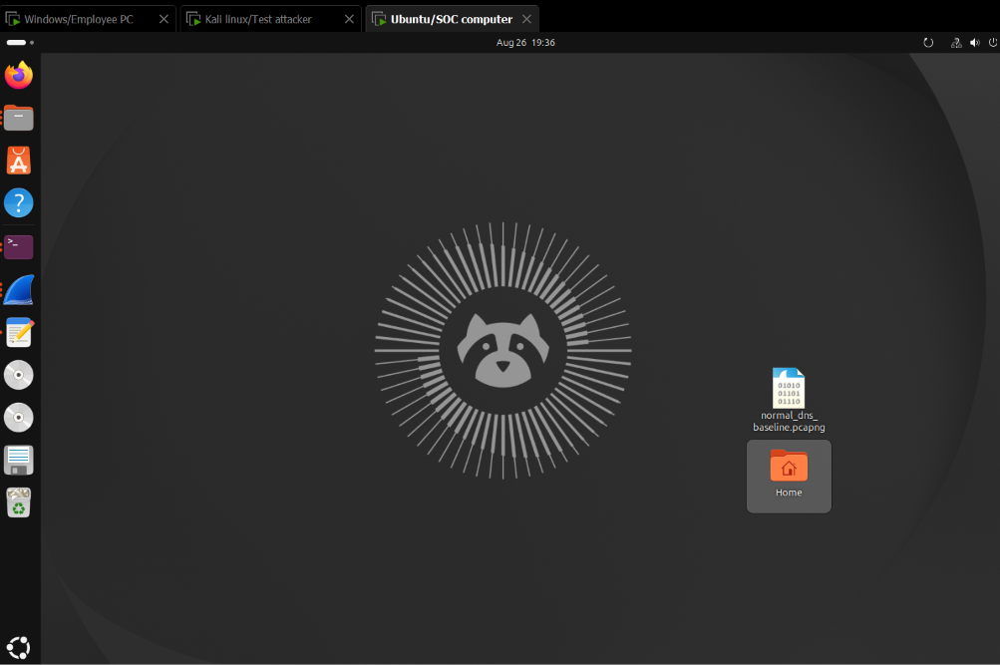

---

## 2. IP Address Configuration

Each machine was assigned an IP address on the same VMware network.

### Kali Linux — Attack Simulation Machine

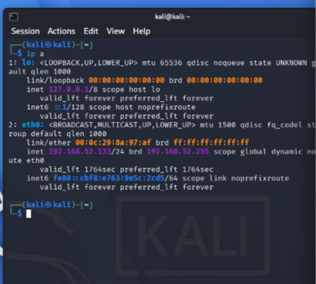

### Ubuntu — SOC / DNS Server

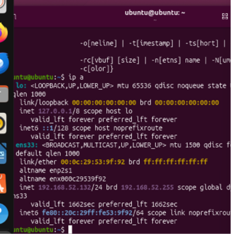

### Windows — Employee Endpoint

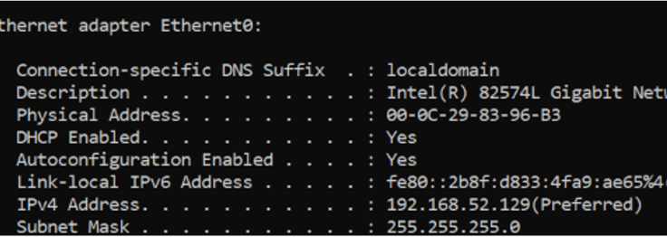

---

## 3. Connectivity Testing

ICMP ping tests were used to confirm communication between the virtual machines.

Verified connectivity included:

- Kali → Ubuntu
- Windows → Ubuntu
- Windows → Kali

### Kali Linux Connectivity Test

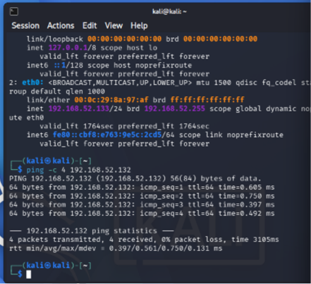

### Windows Connectivity Test

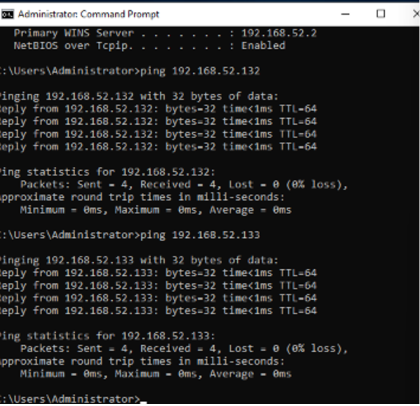

Successful connectivity confirmed that the three systems could communicate inside the isolated lab network.

---

## 4. Ubuntu DNS Server Configuration

Ubuntu was configured as the central DNS server using `dnsmasq`.

The Windows and Kali machines were configured to send DNS requests through the Ubuntu system so that DNS activity could be monitored and analyzed from a central point.

A DNS query from Kali successfully reached the Ubuntu DNS service.

Example dnsmasq log evidence:

```text
query[A] google.com from 192.168.52.133
```

### Ubuntu DNS Server

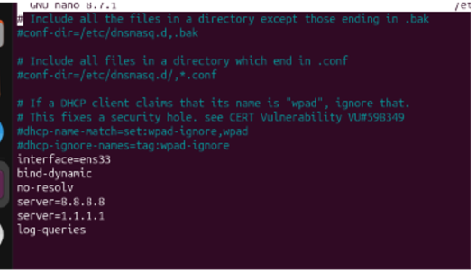

### DNS Server Verification

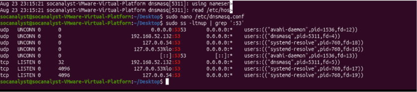

This confirmed that the lab DNS path was functioning correctly before suspicious traffic was generated.

---

# DNS Monitoring

Wireshark and Zeek were used as the main network-monitoring and DNS-analysis tools.

## Wireshark

Wireshark was used for packet-level DNS inspection, including:

- DNS queries
- DNS responses
- Response codes
- Domain names
- Source and destination systems

## Zeek

Zeek was used to convert captured network traffic into structured DNS telemetry.

The primary evidence source was:

```text
dns.log
```

Zeek DNS logs were used to investigate the suspicious traffic generated during the DGA, DNS tunneling, and Fast-Flux test phases.

---

# DGA Analysis

## 5. DGA Behavior Simulation

A controlled DGA-style test was performed from the Kali Linux machine.

Randomly generated domain names were queried under the reserved `.invalid` top-level domain so that the activity remained safe and could not target a real domain.

An initial `.invalid` query was used to verify NXDOMAIN behavior. A burst of **25 random `.invalid` DNS queries** was then generated while Zeek captured the traffic.


### Detection Characteristics

The simulated DGA traffic demonstrated:

- Random-looking domain names
- Large numbers of unique domains
- Failed DNS resolution
- NXDOMAIN responses
- Burst-style DNS activity

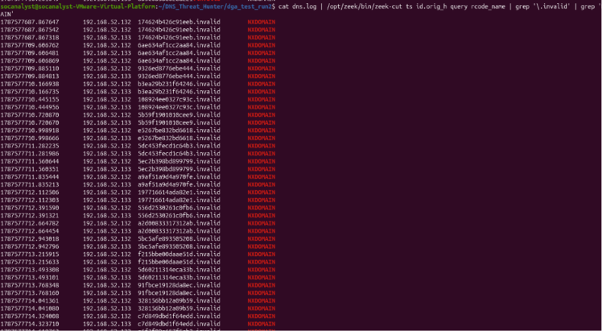

### Analysis

NXDOMAIN responses were treated as an important behavioral indicator because randomly generated domains frequently do not exist.

A high number of unique, random-looking domain queries combined with repeated NXDOMAIN responses can provide analysts with a useful signal for identifying possible DGA activity.

---

# DNS Tunneling Analysis

## 6. DNS Tunneling Behavior Simulation

A controlled DNS tunneling-style test was performed using long, encoded-looking subdomain values.

The controlled test domain was:

```text
tunnel.invalid
```

The purpose was to simulate the way data can be placed inside DNS queries without performing real data exfiltration.

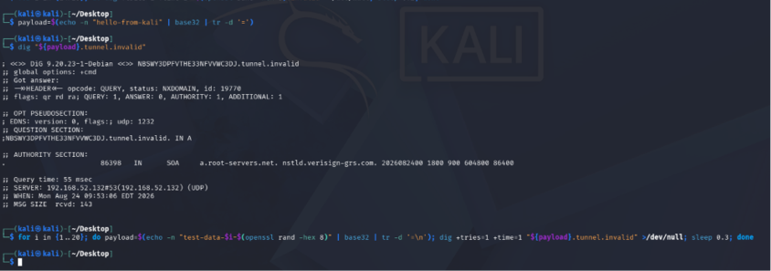

## 7. Zeek Verification

The tunneling-style queries were captured and examined using Zeek `dns.log`.

Traffic associated with the controlled domain was isolated by searching for:

```text
tunnel.invalid
```

The analysis confirmed that the tunneling-style DNS requests were present in the captured Zeek telemetry.

### Detection Characteristics

The tunneling test focused on:

- Long subdomains
- Encoded-looking data
- Repeated queries
- Multiple requests to the same parent domain
- Abnormal DNS query structure

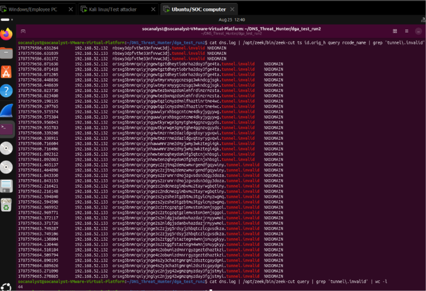

### Analysis

The combination of unusually long subdomains, encoded-looking query data, and repeated requests to the same parent domain provides useful behavioral indicators for identifying possible DNS tunneling activity.

---

# Fast-Flux Analysis

## 8. Fast-Flux Behavior Simulation

A controlled Fast-Flux-style test was performed using a local test domain.

The test focused on DNS behavior involving:

- Multiple IP addresses
- Changing IP addresses
- Very low TTL values
- Rapid DNS infrastructure rotation

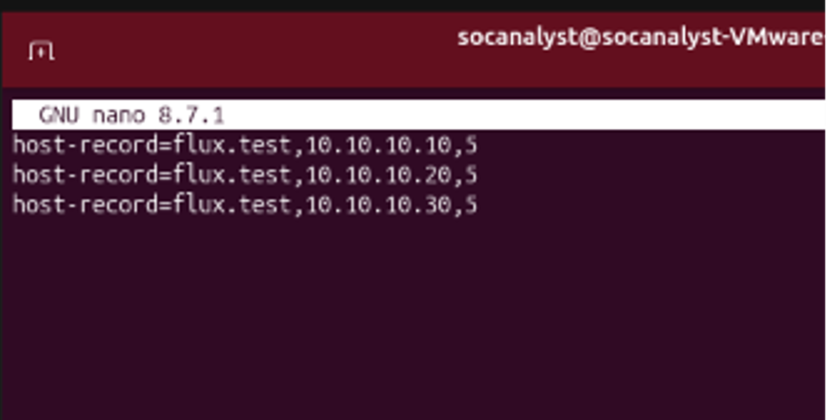

## 9. Zeek Verification

Wireshark and Zeek were used to inspect the generated Fast-Flux-style DNS traffic and verify the expected behavior.

Key indicators included:

- Low TTL values
- Multiple DNS A-record responses
- IP address churn

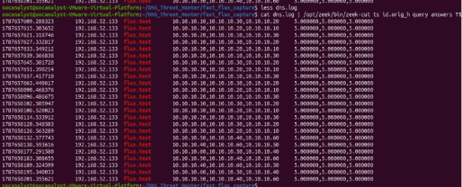

### Analysis

The captured DNS activity demonstrated Fast-Flux indicators by associating the same domain with rapidly changing IP information and short-lived DNS records.

These characteristics can help analysts identify infrastructure designed to rotate backend systems quickly and make malicious services more difficult to block or investigate.

---

# Detection Summary

| Threat Pattern | Main Indicators |
|---|---|
| **DGA** | Random-looking domains, many unique domains, repeated NXDOMAIN responses |
| **DNS Tunneling** | Long subdomains, encoded-looking values, repeated abnormal queries |
| **Fast Flux** | Low TTL values, multiple A records, changing IP addresses |

The project demonstrates how DNS behavior can be analyzed using packet-level inspection and structured network telemetry rather than relying on a single indicator.

---

# Incident Response Perspective

Each threat pattern can be investigated using an Incident Response workflow:

1. **Preparation**
2. **Detection and Analysis**
3. **Containment**
4. **Eradication**
5. **Recovery**
6. **Lessons Learned**

At the current stage, the project has completed the lab preparation, controlled traffic generation, and detection/analysis evidence collection for:

- DGA behavior
- DNS tunneling behavior
- Fast-Flux behavior

Containment, eradication, and recovery actions should only be marked as completed after they are actually demonstrated in the lab.

---

# Security and Ethics

This project is strictly educational and was conducted inside a controlled lab environment.

All suspicious DNS traffic was generated using safe test data and reserved domains such as `.invalid`.

The project does not:

- Attack public DNS infrastructure
- Target real organizations
- Use live malware command-and-control
- Perform real data exfiltration

---

# Repository Structure

```text
DNS-Threat-Hunter/
├── README.md
├── .gitignore
├── docs/
├── detections/
│   ├── dns_hunter.py
│   ├── README.md
│   └── tests/
└── screenshots/
```

### Folder Purpose

- `screenshots/` — visual evidence used throughout the README
- `docs/` — project documentation and reports

---

# Skills Demonstrated

- VMware lab configuration
- Virtual machine networking
- DNS configuration
- dnsmasq
- DNS traffic analysis
- Wireshark
- Zeek
- `dns.log` analysis
- NXDOMAIN investigation
- DGA behavior analysis
- DNS tunneling analysis
- Fast-Flux analysis
- Blue Team threat hunting
- Network security monitoring
- Security evidence documentation
- Incident Response thinking

---

# Author

**Ahmed Osama**
